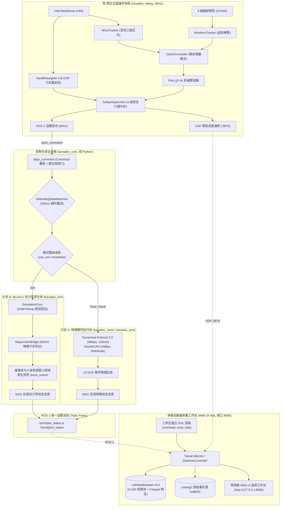

# TuinaDex v2.0 — 中医推拿机械臂-灵巧手具身智能系统 (LEAP Hand & reBot Arm 22-DOF Digital Twin)

[](https://docs.ros.org)
[](https://www.python.org/)
[](https://mujoco.org)
[](https://github.com/huggingface/lerobot)
[](LICENSE)

TuinaDex 是面向中医推拿/理疗场景构建的高性能具身智能机器人系统。
当前阶段实现了 **6-DOF 机械臂 + 16-DOF LEAP Hand 仿生灵巧手 (共 22-DOF)** 的软硬件高保真联合控制与全链路数字闭环：
`ROS2 运行时 / MuJoCo 孪生 -> 60Hz 视-惯遥操作示教 -> Web UI 多模态数据采集 -> LeRobotDataset v3.0 转换 -> 具身策略学习 (SmolVLA/ACT) -> 闭环部署`。

---

## 🤝 协作规范与开发指南 (For Humans & AI Agents)

本项目全面推行**测试驱动开发 (TDD)** 与**分层架构防破坏准则**。
无论是人类开发者还是 AI 编码助手（Claude Code, Cursor, Codex, Windsurf, Copilot, Antigravity），在新增模块、修改代码或发起 Pull Request 前，**必须阅读并严格遵守 [`AGENTS.md`](AGENTS.md)**：

- **黄金不变量**：SI 弧度制（0 rad 全开基准）、22 维绝对关节位置动作空间（严禁增量 delta）、300ms 安全看门狗阻尼平滑回退；
- **五层架构契约**：Layer 1 硬件/物理孪生 $\rightarrow$ Layer 2 驱动/仿真桥 $\rightarrow$ Layer 3 安全控制内核 $\rightarrow$ Layer 4 ROS2 中间件/Hub $\rightarrow$ Layer 5 VLA 策略（严禁跨层调用，严格单一事实源 SSOT）；
- **环境准入门禁**：使用 `source scripts/activate_tuinadex.sh [control|vla]` 局部切换环境，依赖变更必须跑通 `bash scripts/verify_all_envs.sh`；
- **团队协作工作流**：遵循 GitHub Flow 分支管理、Conventional Commits 提交规范以及本地四重门禁验证（环境、构建、单测、E2E）。

---

## 1. 系统架构与多模态数据流 (System Architecture)



---

## 2. 核心架构不变量与设计准则 (Invariants)

1. **统一弧度制与零位契约 (Invariant 1)**:
   - 全链路强制 **SI 国际标准单位：弧度 (rad)**，角速度为 `rad/s`，力矩为 `N·m`，法向力为 `N`；
   - 以实测标定后的 `OPEN_POSE`（全开平伸姿态）为 **0 rad 基准零位**，手指各关节向内屈曲弯曲为正 ($q > 0$)。
2. **动作空间规范 (Invariant 2)**:
   - 动作空间强制使用 **22 维（或 16 维单手模式）绝对关节位置 (Absolute Joint Position)**，严禁使用增量 delta。
3. **话题完全等价性 (Invariant 13)**:
   - 仿真主控与物理真机对外完全共享 `/arm/joint_command`、`/hand/joint_command` 与 `/arm/joint_states`、`/hand/joint_states`；上层遥操、采集与策略节点零感知透明切换。
4. **多速率时钟与动力学解耦 (Invariants 14 & 16)**:
   - MuJoCo 内部物理动力学强制以 500Hz (`dt = 0.002s`) 步进以保障高刚度刚体接触稳定；
   - ROS 2 仿真节点采用单线程 50Hz 定时器锁步执行 10 次子步进，发布端严格降采样至 50Hz，杜绝后台多线程竞态。
5. **硬件安全守护带 (Invariant 15)**:
   - 灵巧手舵机工作电流硬件锁定为 **150mA**，杜绝堵转过热；
   - 通信失联超过 **300ms** 时无条件触发看门狗平滑阻尼回退至安全平伸姿态 (`Relax-to-OPEN`)。

---

## 3. 功能包全景拓扑与文档索引 (Monorepo Packages)

| 目录 / 功能包 | 架构层次 | 核心职责 | 详细文档 |
| :--- | :--- | :--- | :--- |
| **`src/tuinadex_bringup/`** | **Layer 4** (Middleware) | 整机协同部署、Launch 编排与统一 `tuina` CLI 控制台 | [📖 README](src/tuinadex_bringup/README.md) |
| **`src/tuinadex_teleop/`** | **Layer 4** (Middleware) | 60Hz 视-惯正交遥操作系统、三合一标定向导与 OpenCV HUD | [📖 README](src/tuinadex_teleop/README.md) |
| **`src/tuinadex_recorder/`** | **Layer 4** (Middleware) | 基于 `rosbag2_py` 的原始数据事实源进程内高速录制节点 | [📖 README](src/tuinadex_recorder/README.md) |
| **`src/tuinadex_core/`** | **Layer 3** (Control & Safety) | 纯 Python 控制算法、关节规范字典、安全限位门与 300ms 看门狗 | [📖 README](src/tuinadex_core/README.md) |
| **`src/tuinadex_hand/`** | **Layer 2 & 1** (Driver/Hardware) | 16-DOF LEAP Hand 物理驱动、Dynamixel 4Mbps 串口与 150mA 硬限位 | [📖 README](src/tuinadex_hand/README.md) |
| **`src/tuinadex_arm/`** | **Layer 2 & 1** (Driver/Hardware) | 6-DOF reBot 机械臂物理驱动、SocketCAN 1Mbps 通信与 URDF 资产 | [📖 README](src/tuinadex_arm/README.md) |
| **`src/rebot_control/`** | **Layer 2** (Driver Layer) | reBot 机械臂底层电机通信库与 MIT 模式交互式调试 CLI | [📖 README](src/rebot_control/README.md) |
| **`src/tuinadex_sim/`** | **Layer 2 & 1** (Simulation) | 22 维一体化 MuJoCo 动力学数字孪生、500Hz 物理步进与推拿床场景 | [📖 README](src/tuinadex_sim/README.md) |
| **`data/`** | 训练就绪数据集产品库 | `data/tuina_demo` (52 试次, 50k 帧, 22D 臂手 + 3 机位 H.264 LeRobotDataset v3.0) | [📖 说明](dataset/tuinadex_dataset/README.md#3-实测基准数据集-datatuina_demo) |
| **`dataset/tuinadex_dataset/`**| **Layer 5** (AI Policy Prep) | 离线时空对齐、数据校验与 Hugging Face LeRobotDataset v3.0 转换 | [📖 README](dataset/tuinadex_dataset/README.md) |
| **`scripts/`** | 全局基础设施 | 环境激活、自动化 E2E 回归测试脚本、标定向导与数据采集 CLI | [📖 README](scripts/README.md) |
| **`tests/`** | 全局质量防线 | 50+ 自动化单测文件、81 项遥操单测、33 项 Hub 单测与 ROS2 节点集成 | [📖 README](tests/README.md) |
| **`docs/`** | 架构决策与规范 | 系统接口规范 (`specs/`)、设计决策 (`adrs/`) 与架构全景图 (`architecture/`) | [📖 README](docs/README.md) |

---

## 4. 快速上手 (Quickstart)

### 4.1 统一 CLI 控制台启动 (极简免配置 · 推荐)
仓库自带自动环境感知启动脚本 `./bin/tuina`（自动处理 Conda 环境、CycloneDDS 与动态链接库）：

```bash
cd /home/bright/win_office/ubantu_files/project/TuinaDex_v2.0

# 1. 一键启动 22 维物理仿真并弹出 3D 视窗 (机械臂 + 灵巧手 + 推拿床假人)
./bin/tuina launch --sim --gui

# 2. 纯后台无头模式运行仿真 (适用于 CI、录制与自动化测试)
./bin/tuina launch --sim --no-gui

# 3. 启动真实物理机器人驱动 (SocketCAN + 串口)
./bin/tuina launch --real --arm-channel can0 --hand-port /dev/ttyUSB0

# 4. 启动起飞前三合一交互式标定向导 (桌面平面 + 手腕 IMU + 灵巧手活动度)
./bin/tuina teleop calibrate

# 5. 启动 22D 实时协同遥操预览 (Mock 离线体验，带 3D 物理画面与 OpenCV HUD)
./bin/tuina teleop sim --mock

# 6. 启动多模态 Web UI 采集工作台 (浏览器访问 http://localhost:8080)
./bin/tuina collect hub --env sim --mode arm_hand

# 7. 运行全链路采集端到端自检 (真实 EGL 离屏渲染 + H.264 导出)
./bin/tuina collect check
```

---

### 4.2 编译 ROS 2 完整工作空间
```bash
source /opt/ros/lyrical/setup.bash
colcon build --symlink-install
source install/setup.bash
```

---

### 4.3 原生 Launch 编排启动 (`robot.launch.py`)

#### 模式 1: MuJoCo 数字孪生动力学仿真 (`use_sim:=true`)
```bash
# 启动 22 维协同 3D 物理仿真并弹出视窗 (机械臂 + 灵巧手 + 推拿床假人)
ros2 launch tuinadex_bringup robot.launch.py mode:=arm_hand use_sim:=true gui:=true

# 纯后台无头模式运行 (适用于 CI、录制与自动化测试)
ros2 launch tuinadex_bringup robot.launch.py mode:=arm_hand use_sim:=true gui:=false
```

#### 模式 2: 真实物理机器人启动 (`use_sim:=false`)
> [!CAUTION]
> 实体上电前必须确认机械臂急停开关 (E-Stop) 就位，确认串口 `/dev/ttyUSB0` 与 CAN 接口 `can0` 通信正常！

```bash
ros2 launch tuinadex_bringup robot.launch.py mode:=arm_hand use_sim:=false arm_channel:=can0 hand_port:=/dev/ttyUSB0
```

#### 模式 3: 脱机安全 Mock 启动 (CI 与无物理硬件联调推荐)
```bash
ros2 launch tuinadex_bringup robot.launch.py mode:=arm_hand use_sim:=false mock:=true
```

---

## 5. 质量门禁与自动化验证速查表

| 验证目标 | 推荐执行命令 | 预期指标 |
| :--- | :--- | :--- |
| **统一 CLI 命令解析与自检** | `python3 -m pytest tests/test_tuina_cli.py -v` | 15 项全部通过 (<0.1s) |
| **全环境与依赖准入门禁** | `bash scripts/verify_all_envs.sh` | 10 项全 PASSED |
| **核心安全与限位算法单测** | `source scripts/activate_tuinadex.sh control && pytest tests/test_command_processing.py tests/test_watchdog_fsm.py tests/test_tuinadex_core.py tests/test_tuinadex_arm_core.py -q` | 23 项全部通过 (~0.2s) |
| **遥操运动学与感知核心单测** | `source scripts/activate_tuinadex.sh control && pytest tests/teleop/ -q` | 81+ 项全部通过 (~2.5s) |
| **数据采集 Hub 与 API 单测** | `source scripts/activate_tuinadex.sh control && pytest tests/test_camera_rig.py tests/test_episode_buffer.py tests/test_data_channel.py tests/test_data_hub_controller.py tests/test_collection_hub_api.py -q` | 30 项全部通过 (~2.0s) |
| **LeRobot v3.0 数据流式导出单测**| `source scripts/activate_tuinadex.sh vla && pytest tests/test_dataset_sync_validator.py tests/test_lerobot_v3_exporter.py -q` | 6 项全部通过 (~5.0s) |
| **22D 臂手联合控制双模回环** | `bash scripts/e2e_unified_robot_check.sh` | ALL PASS (全绿闭环) |
| **三机位采集 Hub 端到端 E2E** | `bash scripts/e2e_hub_collection_check.sh` | PASS (真实 EGL + H.264) |
