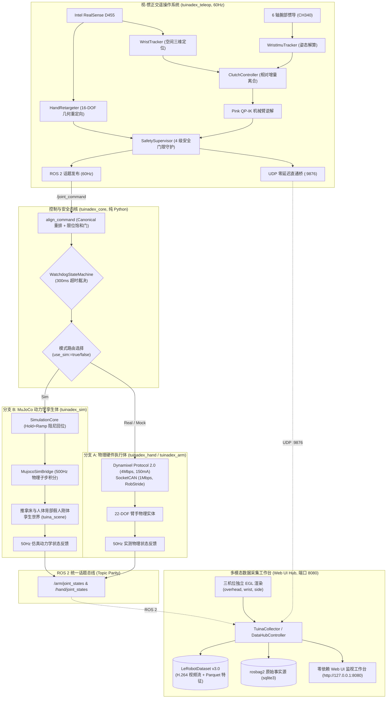
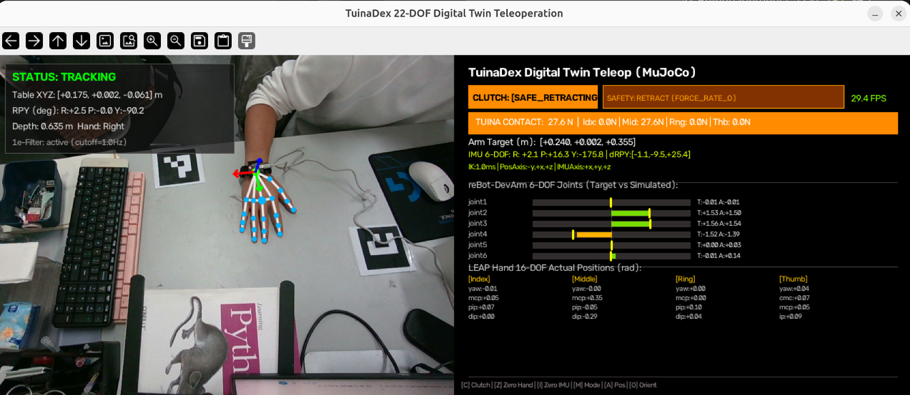

# TuinaDex v2.0 — 中医推拿机械臂-灵巧手具身智能系统 (LEAP Hand & reBot Arm 22-DOF Digital Twin)

[](https://docs.ros.org)
[](https://www.python.org/)
[](https://mujoco.org)
[](https://github.com/huggingface/lerobot)
[](LICENSE)

TuinaDex 是面向中医推拿/理疗场景构建的高性能具身智能机器人系统。
目前已完成 **6-DOF reBot 机械臂 + 16-DOF LEAP Hand 仿生灵巧手 (22-DOF)** 在 **MuJoCo 数字孪生与真实物理硬件双端** 的视-惯遥操验收、多相机 Web UI 数据采集闭环与八大语义域系统级 CLI 控制台 (`tuina`) 全域封装：
`tuina CLI 控制台 / ROS2 运行时 -> 60Hz 视-惯协同真机/仿真遥操 -> 多机位 Web UI 数据采集 -> LeRobotDataset v3.0 -> 具身策略学习 (SmolVLA/ACT)`。

> [!TIP]
> **近期里程碑**:
> - **真机遥操与采集验收通过**：支持 16-DOF 灵巧手超低延迟直驱/ROS 2 双后端 (`tuina teleop hand`)、22-DOF 臂手真机协同 (`tuina teleop composite`)、机械臂拖动示教 Ready Pose (`tuina arm teach`) 及物理 UVC 多相机采集 (`tuina collect hub --env real`)；
> - **系统级 CLI (`tuina`) 全面升级**：收敛为 `launch / teleop / collect / calibrate / arm / hand / data / sys` 八大命令域，自动完成 `tuinadex-control` / `tuinadex-vla` / `ROS 2 Lyrical` 三运行时环境隔离与真机急停交互确认。

---

## 🤝 协作规范与开发指南 (For Humans & AI Agents)

本项目全面推行**测试驱动开发 (TDD)** 与**分层架构防破坏准则**。
无论是人类开发者还是 AI 编码助手（Claude Code, Cursor, Codex, Windsurf, Copilot, Antigravity），在新增模块、修改代码或发起 Pull Request 前，**必须阅读并严格遵守 [`AGENTS.md`](AGENTS.md)**：

- **黄金不变量**：SI 弧度制（0 rad 全开基准）、22 维绝对关节位置动作空间（严禁增量 delta）、300ms 安全看门狗阻尼平滑回退；
- **五层架构契约**：Layer 1 硬件/物理孪生 $\rightarrow$ Layer 2 驱动/仿真桥 $\rightarrow$ Layer 3 安全控制内核 $\rightarrow$ Layer 4 ROS2 中间件/Hub $\rightarrow$ Layer 5 VLA 策略（严禁跨层调用，严格单一事实源 SSOT）；
- **环境准入门禁**：使用 `source scripts/activate_tuinadex.sh [control|vla]` 局部切换环境，依赖变更必须跑通 `bash scripts/verify_all_envs.sh`；
- **团队协作工作流**：遵循 GitHub Flow 分支管理、Conventional Commits 提交规范以及本地四重门禁验证（环境、构建、单测、E2E）。

---

## 1. 系统架构与多模态数据流 (System Architecture)



---

## 2. 核心架构不变量与设计准则 (Invariants)

1. **统一弧度制与零位契约 (Invariant 1)**:
   - 全链路强制 **SI 国际标准单位：弧度 (rad)**，角速度为 `rad/s`，力矩为 `N·m`，法向力为 `N`；
   - 以实测标定后的 `OPEN_POSE`（全开平伸姿态）为 **0 rad 基准零位**，手指各关节向内屈曲弯曲为正 ($q > 0$)。
2. **动作空间规范 (Invariant 2)**:
   - 动作空间强制使用 **22 维（或 16 维单手模式）绝对关节位置 (Absolute Joint Position)**，严禁使用增量 delta。
3. **话题完全等价性 (Invariant 13)**:
   - 仿真主控与物理真机对外完全共享 `/arm/joint_command`、`/hand/joint_command` 与 `/arm/joint_states`、`/hand/joint_states`；上层遥操、采集与策略节点零感知透明切换。
4. **多速率时钟与动力学解耦 (Invariants 14 & 16)**:
   - MuJoCo 内部物理动力学强制以 500Hz (`dt = 0.002s`) 步进以保障高刚度刚体接触稳定；
   - ROS 2 仿真节点采用单线程 50Hz 定时器锁步执行 10 次子步进，发布端严格降采样至 50Hz，杜绝后台多线程竞态。
5. **硬件安全守护带 (Invariant 15)**:
   - 灵巧手舵机工作电流硬件锁定为 **150mA**，杜绝堵转过热；
   - 通信失联超过 **300ms** 时无条件触发看门狗平滑阻尼回退至安全平伸姿态 (`Relax-to-OPEN`)。

---

## 3. 功能包全景拓扑与文档索引 (Monorepo Packages)

| 目录 / 功能包 | 架构层次 | 核心职责 | 详细文档 |
| :--- | :--- | :--- | :--- |
| **`src/tuinadex_bringup/`** | **Layer 4** (Middleware) | 整机协同部署、Launch 编排与八大域系统级 `tuina` CLI 控制台 | [📖 README](src/tuinadex_bringup/README.md) |
| **`src/tuinadex_teleop/`** | **Layer 4** (Middleware) | 60Hz 视-惯正交遥操（真机/仿真）、Web Hub 采集与 OpenCV HUD | [📖 README](src/tuinadex_teleop/README.md) |
| **`src/tuinadex_recorder/`** | **Layer 4** (Middleware) | 基于 `rosbag2_py` 的原始数据事实源进程内高速录制节点 | [📖 README](src/tuinadex_recorder/README.md) |
| **`src/tuinadex_core/`** | **Layer 3** (Control & Safety) | 纯 Python 控制算法、关节规范字典、安全限位门与 300ms 看门狗 | [📖 README](src/tuinadex_core/README.md) |
| **`src/tuinadex_hand/`** | **Layer 2 & 1** (Driver/Hardware) | 16-DOF LEAP Hand 物理驱动、4Mbps 串口、标定/直驱 CLI 与 150mA 硬限位 | [📖 README](src/tuinadex_hand/README.md) |
| **`src/tuinadex_arm/`** | **Layer 2 & 1** (Driver/Hardware) | 6-DOF reBot 机械臂驱动、SocketCAN 1Mbps、拖动示教与 URDF 资产 | [📖 README](src/tuinadex_arm/README.md) |
| **`src/rebot_control/`** | **Layer 2** (Driver Layer) | reBot 机械臂底层电机通信库与 MIT 模式交互式调试 CLI | [📖 README](src/rebot_control/README.md) |
| **`src/tuinadex_sim/`** | **Layer 2 & 1** (Simulation) | 22 维一体化 MuJoCo 动力学数字孪生、500Hz 物理步进与推拿床场景 | [📖 README](src/tuinadex_sim/README.md) |
| **`data/`** | 训练就绪数据集产品库 | `data/tuina_demo` (52 试次, 50k 帧, 22D 臂手 + 3 机位 H.264 LeRobotDataset v3.0) | [📖 说明](dataset/tuinadex_dataset/README.md#3-实测基准数据集-datatuina_demo) |
| **`dataset/tuinadex_dataset/`**| **Layer 5** (AI Policy Prep) | 离线时空对齐、数据校验与 Hugging Face LeRobotDataset v3.0 转换 | [📖 README](dataset/tuinadex_dataset/README.md) |
| **`scripts/`** | 全局基础设施 | 环境激活、拖动示教、自动化 E2E 回归测试与数据采集 CLI | [📖 README](scripts/README.md) |
| **`tests/`** | 全局质量防线 | 40+ 自动化测试文件（37 CLI、107 遥操、31 Hub、ROS 2 隔离集成） | [📖 README](tests/README.md) |
| **`docs/`** | 架构决策与规范 | 系统接口规范 (`specs/`)、设计决策 (`adrs/`)、计划与架构图 (`architecture/`) | [📖 README](docs/README.md) |

---

## 4. 快速上手 (Quickstart)

### 4.1 跨主机克隆与环境自适应初始化 (PC & 香橙派 Orange Pi / aarch64)

无论是在开发机 (x86_64) 还是边缘端单板计算机 (香橙派 Orange Pi AI Pro / 5 aarch64)，推荐标准克隆与自检流程：

```bash
git clone https://github.com/MacroBright/TuinaDex_v2.0.git
cd TuinaDex_v2.0

# 1. 运行系统级环境与硬件总线探针 (自动识别 CPU 架构、ROS 2、总线与环境状态)
./bin/tuina sys env

# 2. 按 CPU 架构就绪环境基座:
# 选项 A: 标准 Linux x86_64 PC / 服务器
conda env create -f scripts/env/tuinadex-control.yml
sudo bash scripts/env/init_dev_pc.sh --install-rules
sudo usermod -aG dialout $USER

# 选项 B: 香橙派 / ARM64 边缘单板机 (Orange Pi aarch64)
# (避免 x86 二进制锁，采用原生 miniforge 构建轻量化环境)
conda create -n tuinadex-control python=3.10 -y && conda activate tuinadex-control
pip install numpy scipy pyyaml opencv-python pinocchio dynamixel-sdk pyserial can-utils pytest
sudo bash scripts/env/init_orangepi.sh --install-all   # 自动安装 1Mbps SocketCAN 开机自启服务与 Udev 规则

# 3. 系统级一键编译 ROS 2 完整工作空间
./bin/tuina sys build

# 4. 可选: 启用系统命令行 Tab 自动补全
./bin/tuina sys completion --install-hint --shell bash
```

---

### 4.2 系统级统一 CLI 控制台 (`tuina` · 运行三模态)
仓库提供全局统一入口 `./bin/tuina`（全局软链 `~/.local/bin/tuina`，自动路由隔离环境并在真机命令前执行硬件前置检查与急停安全确认；支持 `-y/--yes` 跳过确认与 `--dry-run` 预检）：

#### 模态 A. 无硬件仿真体验与开发联调 (`--sim` / `--mock`)
*适用于无物理机器人硬件的开发机、笔记本或 CI 环境，纯软件闭环验证：*
```bash
# 1. 启动 22 维 MuJoCo 物理仿真 (带 3D 视窗 / 加 --no-gui 无头后台运行)
./bin/tuina launch --sim --gui

# 2. 启动 22D 实时协同遥操仿真预览 (带 OpenCV HUD，脱机体验加 --mock)
./bin/tuina teleop sim --mock

# 3. 启动仿真 Web UI 多模态采集工作台 (浏览器访问 http://127.0.0.1:8080)
./bin/tuina collect hub --env sim --mode arm_hand

# 4. 运行全链路采集 E2E 自检 (真实 EGL 离屏渲染 + H.264 导出)
./bin/tuina collect check
```

#### 模态 B. 物理真机标定、遥操与数据采集闭环 (`--real` · 已通过验收)
*适用于香橙派或物理工控机连接真实 6-DOF reBot 机械臂 + 16-DOF LEAP Hand 灵巧手 + USB 相机阵列：*
> [!CAUTION]
> 物理硬件上电前必须确认机械臂急停开关 (E-Stop) 触手可及，工作空间清空！所有 `tuina` 真机命令均会自动执行 `[PREFLIGHT]` CAN/串口检查并要求确认安全。

```bash
# 1. 拉起 1 Mbps SocketCAN 接口并执行准备姿态示教与回位
./bin/tuina arm can up --channel can0 --bitrate 1000000
./bin/tuina arm teach --channel can0        # 拖动示教就绪位并保存至 configs/teleop_real_posture.yaml
./bin/tuina arm goto-ready --channel can0   # 3秒平滑五次多项式插值回位

# 2. 运行桌面 / 手腕 IMU (/dev/myimu) / 灵巧手 ROM 三合一标定向导
./bin/tuina calibrate all

# 3. 启动整机真机协同控制节点
./bin/tuina launch --real

# 4. 启动 16-DOF LEAP Hand 真机单手视觉遥操 (支持 --backend direct|ros2，默认 camera_id=4)
./bin/tuina teleop hand --port /dev/ttyUSB0 --camera-id 4

# 5. 启动 22-DOF 臂手协同真机视觉遥操 (兼容别名: tuina teleop real；无 IMU 加 --no-imu)
./bin/tuina teleop composite --arm-channel can0 --hand-port /dev/ttyUSB0 --no-imu

# 6. 启动真机多相机 Web UI 采集工作台 (自动探测 configs/real_cameras.yaml)
./bin/tuina collect hub --env real --mode arm_hand --cameras overhead,side --fps 60 --max-staleness 0.15
# 打开局域网内任意浏览器访问 http://<主机IP>:8080 即可监视 MJPEG 实时流、遥测波形并执行录制

# 7. 离线将录制的 rosbag2 转为 LeRobotDataset v3.0 并检视特征统计
./bin/tuina data convert --bag bags/session_latest --out data/tuina_real_demo
./bin/tuina data inspect data/tuina_demo
```

#### 模态 C. 视-惯遥操实时 HUD 快捷键操作速查
在 `tuina teleop sim` 或 `tuina teleop composite` 交互视窗中支持高频实时控制：

| 快捷键 | 功能名称 | 行为说明 |
| :--- | :--- | :--- |
| **`[C]`** | 离合器 (Clutch) | 按下/长按激活增量追踪；松开离合保持机械臂位姿冻结 |
| **`[R]` / `[H]`** | 姿态回位 (Ready) | 3秒平滑五次多项式插值回退至推拿就绪姿态 |
| **`[L]`** | 灵巧手保持 (HoldHand) | 锁定当前灵巧手关节角度，机械臂可独立运动 |
| **`[A]`** | 手势平移轴映射切换 (PosAxis) | 切换重定向坐标系轴映射 (如 `x,y,z` $\leftrightarrow$ `x,z,-y`) |
| **`[X]`** | 惯导姿态轴映射切换 (IMUAxis) | 切换手腕 IMU 四元数姿态轴映射 |
| **`[S]`** | 安全限位切换 (Safety) | 切换四级安全门限守护 (Loose / Strict) |
| **`[Z]`** | 零位复位 (Zero) | 重置位移原点至当前手腕位置 |
| **`[Q]` / `[ESC]`** | 安全两阶段退出 (Quit) | 先回正末端关节再平稳阻尼释放总线，安全断开连接 |



---

### 4.3 原生 ROS 2 Launch 编排启动 (`robot.launch.py`)

如需脱离 `tuina` 封装直接使用 ROS 2 原生命令：

#### 模式 1: MuJoCo 数字孪生动力学仿真 (`use_sim:=true`)
```bash
# 启动 22 维协同 3D 物理仿真并弹出视窗 (机械臂 + 灵巧手 + 推拿床假人)
ros2 launch tuinadex_bringup robot.launch.py mode:=arm_hand use_sim:=true gui:=true

# 纯后台无头模式运行 (适用于 CI、录制与自动化测试)
ros2 launch tuinadex_bringup robot.launch.py mode:=arm_hand use_sim:=true gui:=false
```

#### 模式 2: 真实物理机器人启动 (`use_sim:=false`)
```bash
# 步骤 0: 激活并配置 Linux SocketCAN 接口 (1 Mbps，波特率必须为 1000000)
sudo ip link set can0 down 2>/dev/null || true
sudo ip link set can0 up type can bitrate 1000000

# 步骤 1: 启动真实机器人协同运行
ros2 launch tuinadex_bringup robot.launch.py mode:=arm_hand use_sim:=false arm_channel:=can0 hand_port:=/dev/ttyUSB0
```

#### 模式 3: 脱机安全 Mock 启动 (CI 与无物理硬件联调推荐)
```bash
ros2 launch tuinadex_bringup robot.launch.py mode:=arm_hand use_sim:=false mock:=true
```

---

## 5. 质量门禁与自动化验证速查表

| 验证目标 | 推荐执行命令 | 实测指标 |
| :--- | :--- | :--- |
| **系统级 CLI 解析与安全门禁** | `./bin/tuina sys test --suite cli` | **37 passed** (~0.6s) |
| **全环境与依赖准入门禁** | `./bin/tuina sys verify` *(或 `bash scripts/verify_all_envs.sh`)* | **10 项全 PASSED** |
| **核心安全与限位算法单测** | `./bin/tuina sys test --suite core` | **23 passed** (~0.2s) |
| **遥操运动学与感知核心单测** | `./bin/tuina sys test --suite teleop` | **107 passed** |
| **数据采集 Hub 与 API 单测** | `./bin/tuina sys test --suite hub` | **34 passed** |
| **真机 UVC 相机与灵巧手/机械臂驱动** | `source scripts/activate_tuinadex.sh control && pytest tests/test_real_camera_rig.py tests/test_env_management.py tests/test_leap_cli_and_pose_manager.py tests/test_leap_teleop_cli.py tests/test_leap_driver.py tests/test_arm_driver.py tests/test_sim_bridge.py tests/test_sim_core.py -q` | **53 passed** |
| **LeRobot v3.0 数据流式导出单测** | `./bin/tuina sys test --suite dataset` | `3 passed, 2 skipped` *(vla 跳过 rosbag2)* |
| **ROS 2 节点与启动集成测试** | `ROS_DOMAIN_ID=99 ./bin/tuina sys test --suite ros2` | **8 passed** *(CycloneDDS 隔离域)* |
| **22D 臂手联合控制双模回环 E2E** | `./bin/tuina sys e2e --suite unified` | ALL PASS |
| **三机位采集 Hub 端到端 E2E** | `./bin/tuina collect check` *(或 `./bin/tuina sys e2e --suite hub`)* | PASS (真实 EGL + H.264) |
