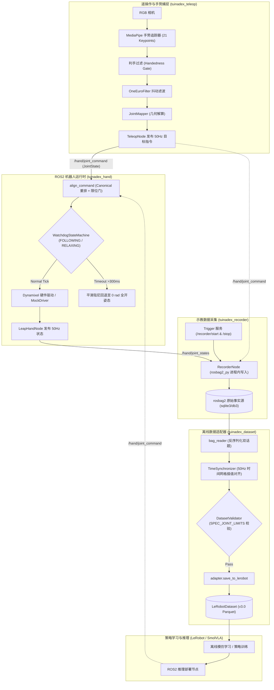

# TuinaDex v2.0 — 中医推拿机械臂-灵巧手具身智能系统 (LEAP Hand MVP)

[](https://docs.ros.org)
[](https://www.python.org/)
[](https://github.com/huggingface/lerobot)
[](LICENSE)

TuinaDex 是面向中医推拿/按摩场景构建的具身智能机器人系统。
当前阶段（MVP）专注于 **16-DOF LEAP Hand 灵巧手** 的最小闭环系统：
`ROS2 运行时 -> 遥操作示教 -> rosbag2 数据记录 -> 离线对齐与校验 -> LeRobot 策略学习 -> ROS2 真机推理部署`。

---

## 1. 系统架构与数据流图 (Architecture & Dataflow)



---

## 2. 核心技术规范与架构不变量 (Invariants)

1. **统一弧度制与零位契约**:
   - ROS2 接口与 LeRobot 数据集全链路强制 **SI 国际标准单位：弧度 (rad)**；
   - 以实测标定后的 `OPEN_POSE`（全开平伸）为 **0 rad 基准零位**，手指各关节向内屈曲弯曲为正 ($q > 0$)。
2. **Canonical 16-DOF 排序**:
   - 顺序固定为：食指(侧摆/俯仰/近指/远指) 4DOF、中指 4DOF、无名指 4DOF、拇指(回转/俯仰/屈曲/指尖) 4DOF。
   - 详见 [`docs/specs/LEAP_HAND_MVP_INTERFACE_SPEC.md`](docs/specs/LEAP_HAND_MVP_INTERFACE_SPEC.md)。
3. **双域架构解耦**:
   - ROS2 负责高频控制回路、硬件通信与看门狗；LeRobot 负责离线学习与策略训练。
   - `rosbag2` 为唯一实验原始事实源，绝不为了适配学习模型改变底层控制协议。
4. **双重限位护栏 (Double Limit Gate)**:
   - 电机控制路径与离线数据集校验路径强制使用同一套逐关节物理限位区间 (`SPEC_JOINT_LIMITS`)，彻底杜绝越界弧度损坏舵机。

---

## 3. 环境准备与多环境矩阵 (Environment Matrix)

由于 Ubuntu 26.04 系统 ROS2 (Lyrical Luth / Python 3.14) 与 LeRobot (Python 3.10) 的环境隔离要求，本项目采用分层环境矩阵：

| 环境 | 路径 / 工具 | 适用模块 | 验证方式 |
| :--- | :--- | :--- | :--- |
| **ROS2 主机环境** | `/opt/ros/lyrical/setup.bash` + `/usr/bin/python3` | `tuinadex_hand`, `tuinadex_recorder`, `rosbag2` 节点与集成测试 | `colcon build`, `pytest tests/test_leap_hand_node_integration.py` |
| **LEAP Hand 纯逻辑环境** | `~/win_office/conda/envs/leap_hand/bin/python` (Python 3.14 + MediaPipe) | 驱动换算、FSM 状态机、限位校验、手势映射单元测试 | `python -m pytest tests/ -v` (28 passed) |
| **LeRobot 训练适配环境** | `~/win_office/conda/envs/smolvla/bin/python` (Python 3.10 + LeRobot 0.4.4) | `tuinadex_dataset` 离线保存与 Parquet 导出 | `python -m pytest tests/test_dataset_adapter.py -v` |

---

## 4. 构建与快速上手 (Quickstart)

### 4.1 编译 ROS2 功能包
```bash
source /opt/ros/lyrical/setup.bash
colcon build --symlink-install
source install/setup.bash
```

### 4.2 运行端到端 Mock 回环验证
无实体硬件环境下，一键运行全链路自动化仿真（Mock 控制节点 + 示教录制 + 50Hz 离线转换 + LeRobot Parquet 生成）：
```bash
bash scripts/e2e_mock_check.sh
```
成功后终端输出：
```text
ROS-side conversion: 147 frames -> /tmp/tuinadex_e2e_XXXX/episode.npz
LeRobot dataset: 147 frames -> /tmp/tuinadex_e2e_XXXX/dataset
[E2E] PASS: mock closed loop completed
```

### 4.3 运行全量单元测试
```bash
# 1. 基础逻辑与遥操映射测试 (leap_hand 环境)
~/win_office/conda/envs/leap_hand/bin/python -m pytest tests/ -v

# 2. LeRobot 数据集适配器测试 (smolvla 环境)
~/win_office/conda/envs/smolvla/bin/python -m pytest tests/test_dataset_sync_validator.py tests/test_dataset_adapter.py -v

# 3. ROS2 节点级集成与录制测试 (ROS2 主机环境)
source /opt/ros/lyrical/setup.bash
python3 -m pytest tests/test_leap_hand_node_integration.py tests/test_recorder_node.py tests/test_dataset_adapter.py -v
```

---

## 5. 项目结构 (Repository Structure)

```text
TuinaDex_v2.0/
├── .agent/                      # 多 Agent 协作接力黑板与状态 (SESSION_STATE.md)
├── docs/
│   ├── specs/                   # 冻结的 16-DOF 接口与通信规范
│   ├── adrs/                    # 架构决策记录 (ADR 0001)
│   └── superpowers/plans/       # Phase 3 实施规划与审查记录
├── dataset/                     # 离线数据处理与 LeRobot 适配器包 (tuinadex_dataset)
│   └── tuinadex_dataset/        # bag_reader, synchronizer, validator, adapter, cli
├── src/                         # ROS2 源码空间
│   ├── tuinadex_hand/           # 灵巧手控制节点、Watchdog 状态机、Dynamixel 驱动
│   ├── tuinadex_recorder/       # 进程内 rosbag2 示教采集节点
│   └── tuinadex_teleop/         # MediaPipe 手势捕捉、单目跟踪与关节映射节点
├── tests/                       # 全量测试套件 (9 个测试模块覆盖单元与集成测试)
├── scripts/                     # 运维与验证脚本 (e2e_mock_check.sh, mock_command_publisher.py)
├── AGENTS.md                    # 项目专属规则层与硬件红线
└── README.md                    # 本文档
```

---

## 6. 核心架构决策记录 (Architecture Decision Records)
- [ADR 0001: LEAP Hand MVP 核心架构决策记录](docs/adrs/0001-architecture-decisions-mvp.md) (状态机选型、rosbag2 采集器、双域解耦、双重限位护栏)
