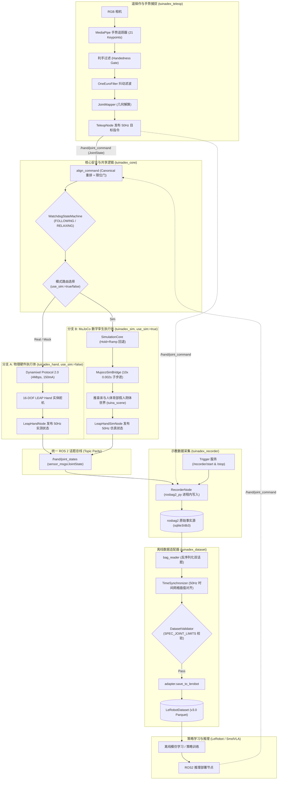

# TuinaDex v2.0 — 中医推拿机械臂-灵巧手具身智能系统 (LEAP Hand MVP & MuJoCo Digital Twin)

[](https://docs.ros.org)
[](https://www.python.org/)
[](https://mujoco.org)
[](https://github.com/huggingface/lerobot)
[](LICENSE)

TuinaDex 是面向中医推拿/理疗场景构建的具身智能机器人系统。
当前阶段专注于 **16-DOF LEAP Hand 灵巧手** 的高可靠软硬件与数字孪生闭环系统：
`ROS2 运行时 / MuJoCo 仿真 -> 遥操作示教 -> rosbag2 数据记录 -> 离线对齐与校验 -> LeRobot 策略学习 -> ROS2 闭环部署`。

---

## 1. 系统架构与数据流图 (Architecture & Dataflow)



---

## 2. 核心技术规范与架构不变量 (Invariants)

1. **统一弧度制与零位契约 (Invariant 1)**:
   - ROS2 接口与 LeRobot 数据集全链路强制 **SI 国际标准单位：弧度 (rad)**；
   - 以实测标定后的 `OPEN_POSE`（全开平伸）为 **0 rad 基准零位**，手指各关节向内屈曲弯曲为正 ($q > 0$)。
2. **Canonical 16-DOF 排序**:
   - 顺序固定为：食指(侧摆/俯仰/近指/远指) 4DOF、中指 4DOF、无名指 4DOF、拇指(回转/俯仰/屈曲/指尖) 4DOF。
   - 详见 [`docs/specs/LEAP_HAND_MVP_INTERFACE_SPEC.md`](docs/specs/LEAP_HAND_MVP_INTERFACE_SPEC.md)。
3. **话题完全等价性 (Invariant 13)**:
   - 仿真主控 `leap_hand_sim_node` 与物理主控 `leap_hand_node` 对外完全共享 `/hand/joint_command` 与 `/hand/joint_states`；上层遥操、采集与策略节点零感知切换。
4. **多速率时钟与物理步进解耦 (Invariants 14 & 16)**:
   - MuJoCo 内部物理动力学以 500Hz (`dt = 0.002s`) 运行以保障接触积分稳定；
   - ROS 2 仿真节点采用单线程 50Hz Timer，每 tick 内锁步执行 10 次子步进 (`10 x 0.002s = 20ms`)，发布端严格降采样至 50Hz，杜绝后台线程竞态。
5. **共享纯逻辑下沉与无环依赖 (Invariant 17)**:
   - `tuinadex_core` 承载 `align_command`、`JOINT_SPEC_LIMITS` 与 `WatchdogStateMachine`，彻底切断 `tuinadex_hand` 与 `tuinadex_sim` 循环依赖。
6. **双模看门狗与平滑回退 (Invariants 15 & 18)**:
   - 两端均内置 300ms Watchdog；失联时复刻 `0.3s hold + 0.6s ramp` 阻尼回退至全开平伸姿态 (`Relax-to-OPEN`)，杜绝机械冲击与仿真冲量发散。

---

## 3. 环境准备与多环境矩阵 (Environment Matrix)

由于 Ubuntu 26.04 系统 ROS2 (Lyrical Luth / Python 3.14) 与 LeRobot (Python 3.10) 的环境隔离要求，本项目采用分层环境矩阵：

| 环境 | 路径 / 工具 | 适用模块 | 验证方式 |
| :--- | :--- | :--- | :--- |
| **ROS2 主机环境** | `/opt/ros/lyrical/setup.bash` + `/usr/bin/python3` (MuJoCo 3.13) | `tuinadex_core`, `tuinadex_hand`, `tuinadex_sim`, `tuinadex_recorder` 编译与 ROS2 集成测试 | `colcon build`, `pytest tests/test_leap_hand_node_integration.py tests/test_sim_node_integration.py` |
| **LEAP Hand 纯逻辑环境** | `~/win_office/conda/envs/leap_hand/bin/python` (Python 3.14 + MediaPipe) | 驱动换算、FSM 状态机、限位校验、手势映射、MuJoCo 动力学核心单测 | `python -m pytest tests/ -v` (47 passed) |
| **LeRobot 训练适配环境** | `~/win_office/conda/envs/smolvla/bin/python` (Python 3.10 + LeRobot 0.4.4) | `tuinadex_dataset` 离线保存与 Parquet 导出 | `python -m pytest tests/test_dataset_adapter.py -v` |

---

## 4. 构建与快速上手 (Quickstart)

### 4.1 编译 ROS2 功能包 (5 包全量)
```bash
source /opt/ros/lyrical/setup.bash
colcon build --symlink-install --packages-select tuinadex_core tuinadex_hand tuinadex_teleop tuinadex_recorder tuinadex_sim
source install/setup.bash
```

### 4.2 双模式一键启动 (Dual-Mode Launch)

#### 模式 1: MuJoCo 数字孪生仿真启动 (推荐验证模式)
```bash
# 启动 MuJoCo 仿真环境 (包含中医推拿床与人体背部假人模型，发布 50Hz 仿真关节状态)
ros2 launch tuinadex_hand hand.launch.py use_sim:=true
```

#### 模式 2: 真实物理硬件 / Mock 驱动启动
```bash
# 启动真实硬件驱动 (需连接 USB-TTL 串口 /dev/ttyUSB0 并获授权)
ros2 launch tuinadex_hand hand.launch.py use_sim:=false port:=/dev/ttyUSB0

# 启动硬件 Mock 模式 (无物理串口时回环自检)
ros2 launch tuinadex_hand hand.launch.py use_sim:=false mock:=true
```

#### 启动遥操作手势捕捉 (可选)
```bash
ros2 launch tuinadex_teleop teleop.launch.py
```

### 4.3 自动化端到端回环验证 (E2E Checks)

- **MuJoCo 仿真统一入口闭环自检**:
  ```bash
  bash scripts/e2e_sim_check.sh
  ```
  *验证指标: 50Hz 控制发布、MuJoCo 10 步/tick 积分、130+ 帧状态接收、周期中位数 19.97ms、物理收敛并平滑回退 OPEN。*

- **Mock 驱动示教录制与数据集转换闭环自检**:
  ```bash
  bash scripts/e2e_mock_check.sh
  ```
  *验证指标: Mock 控制节点 + 示教录制 + 50Hz 离线时间对齐 + LeRobot Parquet 数据集落地。*

### 4.4 运行多矩阵单元测试
```bash
# 1. 基础逻辑、遥操映射与仿真桥接测试 (leap_hand 环境)
~/win_office/conda/envs/leap_hand/bin/python -m pytest tests/ -v

# 2. LeRobot 数据集适配器测试 (smolvla 环境)
~/win_office/conda/envs/smolvla/bin/python -m pytest tests/test_dataset_sync_validator.py tests/test_dataset_adapter.py -v

# 3. ROS2 节点级集成与双模测试 (ROS2 主机环境)
source /opt/ros/lyrical/setup.bash
python3 -m pytest tests/test_leap_hand_node_integration.py tests/test_recorder_node.py tests/test_sim_node_integration.py -v
```

---

## 5. 项目结构 (Repository Structure)

```text
TuinaDex_v2.0/
├── .agent/                      # 多 Agent 协作接力黑板与状态 (SESSION_STATE.md)
├── docs/
│   ├── specs/                   # 冻结的 16-DOF 接口与通信规范
│   ├── adrs/                    # 架构决策记录 (ADR 0001: MVP, ADR 0002: Simulation)
│   ├── architecture/            # 交互式架构全景图 (tuinadex_sim_digital_twin.html)
│   └── superpowers/plans/       # Phase 3 实施规划与审查记录
├── dataset/                     # 离线数据处理与 LeRobot 适配器包 (tuinadex_dataset)
│   └── tuinadex_dataset/        # bag_reader, synchronizer, validator, adapter, cli
├── src/                         # ROS2 源码空间 (5 个模块化功能包)
│   ├── tuinadex_core/           # 共享纯逻辑包 (规范关节名、逐关节限位、align_command、Watchdog FSM)
│   ├── tuinadex_hand/           # 物理灵巧手运行时、统一 launch、Dynamixel 串口驱动
│   ├── tuinadex_sim/            # MuJoCo 数字孪生包 (URDF/STL 资产、tuina_scene.xml、MujocoSimBridge)
│   ├── tuinadex_recorder/       # 进程内 rosbag2 示教采集节点
│   └── tuinadex_teleop/         # MediaPipe 手势捕捉、单目跟踪与关节映射节点
├── tests/                       # 全量测试套件 (47+ 单元测试覆盖核心驱动、仿真与集成回路)
├── scripts/                     # 自动化测试与辅助脚本 (e2e_sim_check.sh, e2e_mock_check.sh)
├── AGENTS.md                    # 项目专属规则层与硬件红线
└── README.md                    # 本文档
```

---

## 6. 核心架构决策记录 (Architecture Decision Records)
- [ADR 0001: LEAP Hand MVP 核心架构决策记录](docs/adrs/0001-architecture-decisions-mvp.md) (状态机选型、rosbag2 采集器、双域解耦、双重限位护栏)
- [ADR 0002: MuJoCo 仿真数字孪生与真机统一切换架构决策记录](docs/adrs/0002-architecture-decisions-sim.md) (tuinadex_core 下沉、单线程 50Hz/500Hz 步进、Hold+Ramp 回退保真、统一启动切换)
