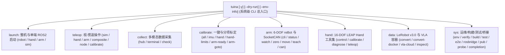
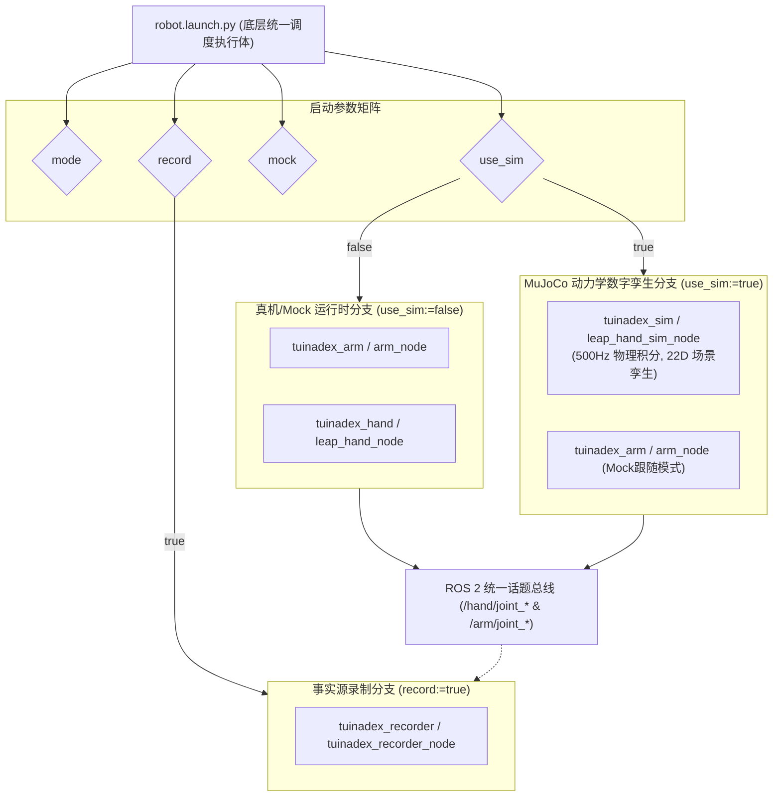

# tuinadex_bringup: 整机统一协同部署、启动编排与 Unified CLI

`tuinadex_bringup` 是 TuinaDex v2.0 中医推拿机械臂-灵巧手具身智能系统的 **整机统一部署、多模调度、Launch 编排与统一 CLI 控制台功能包（Layer 4: Middleware Layer）**。

本包提供两大核心能力：
1. **TuinaDex Unified CLI (`tuina`)**: 提供免配置、自感知环境的统一命令行总控门面（`./bin/tuina` 或 `ros2 run tuinadex_bringup tuina`），自动串联整机启动（`tuina launch`）、仿真遥操（`tuina teleop`）、三合一标定与多模态数据采集工作台（`tuina collect`）；
2. **整机协同 Launch 编排 (`robot.launch.py`)**: 将 6-DOF reBot 机械臂、16-DOF LEAP Hand 灵巧手、MuJoCo 3D 数字孪生仿真、脱机安全 Mock 节点以及 rosbag2 示教数据录制节点无缝聚合，支持单手、单臂与 22 维臂手联合的多场景一键拉起。

---

## 快速开始 (Quick Start)

### 1. 方式 A：使用 TuinaDex 统一 CLI 控制台 (推荐 · 免配置)
`bin/tuina` 具备自动环境感知能力，会自动定位 `tuinadex-control` Conda 环境、配置 CycloneDDS、加载 ROS 2 Lyrical 基准并修复 Pinocchio 动态链接库，直接开箱即用：

```bash
cd /home/bright/win_office/ubantu_files/project/TuinaDex_v2.0

# 1. 查看 CLI 整体帮助与环境自检诊断
./bin/tuina --help
./bin/tuina --env-info

# 2. 一键拉起 22 维物理仿真并弹出 3D 视窗 (机械臂 + 灵巧手 + 推拿床假人)
./bin/tuina launch --sim --gui

# 3. 纯后台无头模式运行仿真 (适用于 CI、录制与自动化测试)
./bin/tuina launch --sim --no-gui

# 4. 启动真实物理硬件底座 (SocketCAN + 串口)
./bin/tuina launch --real --arm-channel can0 --hand-port /dev/ttyUSB0

# 5. 脱机安全 Mock 启动 (无物理硬件联调)
./bin/tuina launch --mock

# 6. 一键启动 16-DOF LEAP Hand 真实硬件视觉遥操作 (超低延迟串口直驱)
./bin/tuina teleop hand --port /dev/ttyUSB0 --camera-id 4

# 7. 一键启动 16-DOF 灵巧手 ROS 2 节点化真机遥操 (解耦发布 /hand/joint_command)
./bin/tuina teleop hand --backend ros2 --camera-id 4

# 8. 一键启动 22-DOF 臂手联合真机视觉遥操作 (Arm + Hand 协同真机遥操)
./bin/tuina teleop composite --arm-channel can0 --hand-port /dev/ttyUSB0

# 9. 一键启动 22D 仿真遥操交互预览 (带 3D 物理画面与 OpenCV HUD 仪表盘)
./bin/tuina teleop sim --mock

# 10. 一键启动起飞前三合一标定向导 (桌面平面 + 手腕 IMU + 灵巧手活动度)
./bin/tuina teleop calibrate

# 8. 一键启动 Web UI 数据采集工作台 (浏览器访问 http://localhost:8080)
./bin/tuina collect hub --env sim --mode arm_hand

# 9. 纯终端离线快速采集 5 个推拿试次
./bin/tuina collect terminal --episodes 5 --frames-per-episode 150

# 10. 一键运行采集与导出自动化端到端 E2E 自检 (离屏 EGL + H.264 MP4)
./bin/tuina collect check
```

---

### 2. 方式 B：ROS 2 原生 Launch 编排启动 (`robot.launch.py`)

#### 环境准备与工作空间构建
```bash
source /opt/ros/lyrical/setup.bash

# 构建 bringup 及其依赖功能包
colcon build --symlink-install --packages-select tuinadex_bringup tuinadex_arm tuinadex_hand tuinadex_sim tuinadex_recorder
source install/setup.bash
```

#### 常用原生 Launch 指令
```bash
# 1. 22 维一体化 3D 物理仿真 (推荐开发与可视化体验)
ros2 launch tuinadex_bringup robot.launch.py mode:=arm_hand use_sim:=true gui:=true

# 2. 22 维仿真无头模式 + 一键示教录制
ros2 launch tuinadex_bringup robot.launch.py mode:=arm_hand use_sim:=true gui:=false record:=true

# 3. 真实物理机器人启动 (急停开关 E-Stop 处于就绪状态)
ros2 launch tuinadex_bringup robot.launch.py mode:=arm_hand use_sim:=false arm_channel:=can0 hand_port:=/dev/ttyUSB0

# 4. 脱机安全 Mock 启动
ros2 launch tuinadex_bringup robot.launch.py mode:=arm_hand use_sim:=false mock:=true
```

---

## 1. 统一 CLI 体系结构 (`tuina`)

`tuinadex_bringup` 下的 `cli/` 模块实现了系统级八大语义域 CLI 门面（全局软链 `~/.local/bin/tuina -> bin/tuina`），自动实施 **三运行时环境硬隔离 (`control` Python 3.10 / `vla` Python 3.10+CUDA / `ros2` Lyrical Python 3.14)** 与 **真机硬件前置自检 + 交互式急停确认门禁 (`-y`/`--yes`)**：



### Shell 自动补全 (Bash / Zsh)
```bash
# 查看安装单行指令并启用 Tab 补全
tuina sys completion --install-hint --shell bash   # 或 --shell zsh
```

### `tuina` 子命令参数速查

#### 1.1 `tuina launch` (整机与分系统级调度)
| 参数选项 | 类型 | 默认值 | 作用与说明 |
| :--- | :--- | :--- | :--- |
| `--target` | Choice | `robot` | 启动目标：`robot`, `hand`, `arm`, `sim` |
| `--sim` / `--real` / `--mock` | Flag | `--sim` | MuJoCo 仿真 / 物理真机（触发安全门禁）/ 脱机安全 Mock |
| `--mode` | Choice | `arm_hand` | 自由度形态：`arm_hand` (22D), `hand_only` (16D), `arm_only` (6D) |
| `--gui` / `--no-gui` | Flag | `--gui` | 仿真中弹出 3D 视窗或无头后台运行 |
| `--use-scene-world` / `--no-scene-world` | Flag | `None` | 是否加载推拿床与假人完整孪生场景 |
| `--physics-substeps` | Int | `None` | MuJoCo 物理子步数 (`hand` / `sim` 目标) |
| `--record` | Flag | `False` | 同时拉起 `tuinadex_recorder_node` 录制至 `rosbag2` |
| `--arm-channel` / `--hand-port` | String | `can0` / `/dev/ttyUSB0` | 机械臂 SocketCAN 与灵巧手串口路径 |
| `--rate-hz` / `--watchdog-timeout` | Float | `50.0` / `0.30` | 主控周期频率与看门狗超时回退时间 |

#### 1.2 全域高阶域速查
| 域 | 核心子命令示例 | 说明 |
| :--- | :--- | :--- |
| `teleop` | `tuina teleop sim --mock` / `composite --arm-channel can0` / `calibrate [--imu-only]` | 视-惯遥操（`calibrate` 默认 IMU `/dev/myimu` 且自动探测相机） |
| `collect` | `tuina collect hub --env sim` / `terminal --env real --camera-map ...` / `check` | Web UI Hub、终端录制与 E2E 校验 |
| `calibrate` | `tuina calibrate all` / `imu` / `hand` / `hand-limits` / `arm-ready` / `arm-goto` | 一键起飞前标定、手腕 IMU、灵巧手与机械臂姿态校准 |
| `arm` | `tuina arm status` / `watch` / `move -j 1 -a 15` / `zero` / `can up --bitrate 1000000` | 6-DOF reBot 控制与 1Mbps SocketCAN 管理（高危命令带急停确认） |
| `hand` | `tuina hand control` / `calibrate` / `diagnose` / `teleop` | 16-DOF LEAP Hand 工具集（保留 `leap-*` 兼容命令） |
| `data` | `tuina data convert --bag ... --out ...` / `inspect <dir>` / `convert-docker` / `vla-cloud` | 严格路由至 `tuinadex-vla` 隔离转换与检视 |
| `sys` | `tuina sys env` / `verify` / `build` / `test --suite teleop` / `e2e --suite unified` / `rosbridge` | 全系统环境检查、编译、分域单测、E2E 与桥接运维 |

---

## 2. Launch 编排拓扑与架构



---

## 3. 全局统一配置文件 (`config/robot_params.yaml`)

集中声明整个机器人系统的默认硬件与动力学参数：
- **`global`**: 默认运行模式与 50Hz 速率、300ms 看门狗；
- **`arm`**: CAN 通道 `can0`、波特率 1Mbps、主机 ID 253、限速 30 deg/s；
- **`hand`**: 串口 `/dev/ttyUSB0`、波特率 4Mbps、电流硬限位 150mA；
- **`sim`**: 物理步长 0.002s (500Hz)、单周期 10 次子步进 (50Hz 同步)。

---

## 4. 目录结构

```
src/tuinadex_bringup/
├── config/
│   └── robot_params.yaml         # 臂手协同全局参数声明
├── launch/
│   └── robot.launch.py           # 整机核心调度与多模条件分支启动脚本
├── resource/
│   └── tuinadex_bringup          # ROS 2 包索引
├── tuinadex_bringup/
│   ├── __init__.py
│   └── cli/                      # TuinaDex 统一 CLI 控制台核心实现
│       ├── __init__.py
│       ├── main.py               # tuina CLI 根解析器与入口
│       ├── launch.py             # tuina launch 子命令路由 (对接 robot.launch.py)
│       ├── teleop.py             # tuina teleop 子命令路由
│       ├── collect.py            # tuina collect 子命令路由
│       └── env_detector.py       # Conda 与 ROS 2 动态环境自感知探测器
├── package.xml                   # 依赖汇总声明
└── setup.py                      # 安装规则、Launch 映射与 tuina 命令入口注册
```

---

## 5. 单元测试与闭环验证

```bash
# 1. 验证 tuina 统一 CLI 全量解析单测 (包含 launch, teleop, collect, dry-run 15 项全部通过)
python3 -m pytest tests/test_tuina_cli.py -v

# 2. 运行 22 维一体化机器人端到端闭环自检
bash scripts/e2e_unified_robot_check.sh
```

**预期输出指标**:
```
tests/test_tuina_cli.py::test_get_repo_root PASSED                       [  6%]
tests/test_tuina_cli.py::test_get_conda_python PASSED                    [ 13%]
tests/test_tuina_cli.py::test_cli_help PASSED                            [ 20%]
tests/test_tuina_cli.py::test_teleop_sim_args PASSED                     [ 26%]
tests/test_tuina_cli.py::test_collect_hub_args PASSED                    [ 46%]
tests/test_tuina_cli.py::test_launch_sim_args PASSED                     [ 66%]
tests/test_tuina_cli.py::test_launch_real_args PASSED                    [ 73%]
tests/test_tuina_cli.py::test_launch_mock_args PASSED                    [ 80%]
tests/test_tuina_cli.py::test_dispatch_launch_dry_run PASSED             [ 86%]
...
============================== 15 passed in 0.05s ==============================
```
