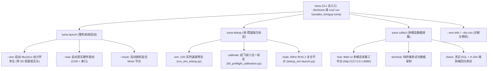
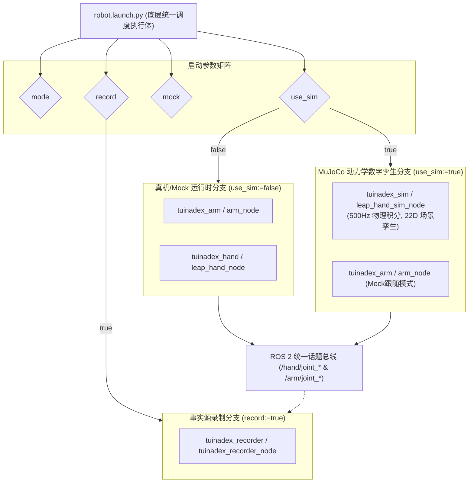

# tuinadex_bringup: 整机统一协同部署、启动编排与 Unified CLI

`tuinadex_bringup` 是 TuinaDex v2.0 中医推拿机械臂-灵巧手具身智能系统的 **整机统一部署、多模调度、Launch 编排与统一 CLI 控制台功能包（Layer 4: Middleware Layer）**。

本包提供两大核心能力：
1. **TuinaDex Unified CLI (`tuina`)**: 提供免配置、自感知环境的统一命令行总控门面（`./bin/tuina` 或 `ros2 run tuinadex_bringup tuina`），自动串联整机启动（`tuina launch`）、仿真遥操（`tuina teleop`）、三合一标定与多模态数据采集工作台（`tuina collect`）；
2. **整机协同 Launch 编排 (`robot.launch.py`)**: 将 6-DOF reBot 机械臂、16-DOF LEAP Hand 灵巧手、MuJoCo 3D 数字孪生仿真、脱机安全 Mock 节点以及 rosbag2 示教数据录制节点无缝聚合，支持单手、单臂与 22 维臂手联合的多场景一键拉起。

---

## 快速开始 (Quick Start)

### 1. 方式 A：使用 TuinaDex 统一 CLI 控制台 (推荐 · 免配置)
`bin/tuina` 具备自动环境感知能力，会自动定位 `tuinadex-control` Conda 环境、配置 CycloneDDS、加载 ROS 2 Lyrical 基准并修复 Pinocchio 动态链接库，直接开箱即用：

```bash
cd /home/bright/win_office/ubantu_files/project/TuinaDex_v2.0

# 1. 查看 CLI 整体帮助与环境自检诊断
./bin/tuina --help
./bin/tuina --env-info

# 2. 一键拉起 22 维物理仿真并弹出 3D 视窗 (机械臂 + 灵巧手 + 推拿床假人)
./bin/tuina launch --sim --gui

# 3. 纯后台无头模式运行仿真 (适用于 CI、录制与自动化测试)
./bin/tuina launch --sim --no-gui

# 4. 启动真实物理硬件底座 (SocketCAN + 串口)
./bin/tuina launch --real --arm-channel can0 --hand-port /dev/ttyUSB0

# 5. 脱机安全 Mock 启动 (无物理硬件联调)
./bin/tuina launch --mock

# 6. 一键启动 22D 仿真遥操交互预览 (带 3D 物理画面与 OpenCV HUD 仪表盘)
./bin/tuina teleop sim --mock

# 7. 一键启动起飞前三合一标定向导 (桌面平面 + 手腕 IMU + 灵巧手活动度)
./bin/tuina teleop calibrate

# 8. 一键启动 Web UI 数据采集工作台 (浏览器访问 http://localhost:8080)
./bin/tuina collect hub --env sim --mode arm_hand

# 9. 纯终端离线快速采集 5 个推拿试次
./bin/tuina collect terminal --episodes 5 --frames-per-episode 150

# 10. 一键运行采集与导出自动化端到端 E2E 自检 (离屏 EGL + H.264 MP4)
./bin/tuina collect check
```

---

### 2. 方式 B：ROS 2 原生 Launch 编排启动 (`robot.launch.py`)

#### 环境准备与工作空间构建
```bash
source /opt/ros/lyrical/setup.bash

# 构建 bringup 及其依赖功能包
colcon build --symlink-install --packages-select tuinadex_bringup tuinadex_arm tuinadex_hand tuinadex_sim tuinadex_recorder
source install/setup.bash
```

#### 常用原生 Launch 指令
```bash
# 1. 22 维一体化 3D 物理仿真 (推荐开发与可视化体验)
ros2 launch tuinadex_bringup robot.launch.py mode:=arm_hand use_sim:=true gui:=true

# 2. 22 维仿真无头模式 + 一键示教录制
ros2 launch tuinadex_bringup robot.launch.py mode:=arm_hand use_sim:=true gui:=false record:=true

# 3. 真实物理机器人启动 (急停开关 E-Stop 处于就绪状态)
ros2 launch tuinadex_bringup robot.launch.py mode:=arm_hand use_sim:=false arm_channel:=can0 hand_port:=/dev/ttyUSB0

# 4. 脱机安全 Mock 启动
ros2 launch tuinadex_bringup robot.launch.py mode:=arm_hand use_sim:=false mock:=true
```

---

## 1. 统一 CLI 体系结构 (`tuina`)

`tuinadex_bringup` 下的 `cli/` 模块实现了统一命令行门面，提供清晰的子命令树与环境变量透传机制：



### `tuina` 子命令参数速查

#### 1.1 `tuina launch` (整机系统级调度)
将 `robot.launch.py` 的底层复杂参数提炼为开箱即用的语义选项：

| 参数选项 | 类型 | 默认值 | 作用与说明 |
| :--- | :--- | :--- | :--- |
| `--sim` | Flag | `True` (默认) | 启动 MuJoCo 动力学数字孪生仿真引擎 |
| `--real` | Flag | `False` | 启动物理真机驱动（SocketCAN 机械臂 + Dynamixel 灵巧手） |
| `--mock` | Flag | `False` | 启用脱机安全 Mock 驱动，绝不向物理总线写电 |
| `--mode` | Choice | `arm_hand` | 自由度形态：`arm_hand` (22D), `hand_only` (16D), `arm_only` (6D) |
| `--gui` / `--no-gui` | Flag | `--gui` | 仿真中是否弹出 MuJoCo 3D 交互视窗（`--no-gui` 为无头模式） |
| `--record` | Flag | `False` | 是否同时拉起 `tuinadex_recorder_node` 录制话题至 `rosbag2` |
| `--arm-channel` | String | `can0` | 机械臂通信 SocketCAN 接口名称 |
| `--hand-port` | String | `/dev/ttyUSB0` | 灵巧手 U2D2 通信串口路径 |
| `--rate-hz` | Float | `50.0` | 控制与状态发布基准主频 (Hz) |
| `--watchdog-timeout` | Float | `0.30` | 指令失联超时安全回退时间 (s) |

#### 1.2 `tuina teleop` 与 `tuina collect`
| 子命令 | 关键选项 | 默认值 | 作用说明 |
| :--- | :--- | :--- | :--- |
| `teleop sim` | `--mock` | `false` | 启用脱机模拟手势与测试轨迹 |
| | `--no-gui` | `false` | 纯终端无头运行，禁用 OpenCV HUD 视窗 |
| | `--solver-mode` | `hybrid` | 灵巧手解算器模式：`hybrid`, `geometric`, `dex_retargeting` |
| | `--axis-mapping` | `-y,+x,+z` | 人手位姿至机械臂基座空间轴向映射 |
| `teleop calibrate` | `--imu-only` | `false` | 仅对手腕 6 轴 IMU 进行 3 姿态正交零位标定 |
| | `--camera-id` | `0` | RealSense 相机设备索引 |
| | `--imu-port` | `/dev/ttyUSB0` | IMU 串口设备路径 |
| `teleop node` | `--rate-hz` | `60.0` | 遥操作发布主频 (Hz) |
| | `--camera-fps`| `60` | 相机采集帧率 (USB3 推荐 60，USB2 自动降频至 30) |
| `collect hub` | `--env` | `sim` | 采集环境：`sim` (MuJoCo) 或 `real` (真实物理机) |
| | `--mode` | `arm_hand` | 联合维度：`arm_hand` (22D) 或 `hand_only` (16D) |
| | `--port` | `8080` | Web UI 工作台服务端口 |
| | `--cameras` | `overhead,wrist,side` | 采集与推流相机列表 |
| | `--fps` | `50` | 离线 LeRobotDataset 重采样基准帧率 |
| `collect terminal`| `--episodes` | `1` | 连续采集并导出的试次数量 |

---

## 2. Launch 编排拓扑与架构



---

## 3. 全局统一配置文件 (`config/robot_params.yaml`)

集中声明整个机器人系统的默认硬件与动力学参数：
- **`global`**: 默认运行模式与 50Hz 速率、300ms 看门狗；
- **`arm`**: CAN 通道 `can0`、波特率 1Mbps、主机 ID 253、限速 30 deg/s；
- **`hand`**: 串口 `/dev/ttyUSB0`、波特率 4Mbps、电流硬限位 150mA；
- **`sim`**: 物理步长 0.002s (500Hz)、单周期 10 次子步进 (50Hz 同步)。

---

## 4. 目录结构

```
src/tuinadex_bringup/
├── config/
│   └── robot_params.yaml         # 臂手协同全局参数声明
├── launch/
│   └── robot.launch.py           # 整机核心调度与多模条件分支启动脚本
├── resource/
│   └── tuinadex_bringup          # ROS 2 包索引
├── tuinadex_bringup/
│   ├── __init__.py
│   └── cli/                      # TuinaDex 统一 CLI 控制台核心实现
│       ├── __init__.py
│       ├── main.py               # tuina CLI 根解析器与入口
│       ├── launch.py             # tuina launch 子命令路由 (对接 robot.launch.py)
│       ├── teleop.py             # tuina teleop 子命令路由
│       ├── collect.py            # tuina collect 子命令路由
│       └── env_detector.py       # Conda 与 ROS 2 动态环境自感知探测器
├── package.xml                   # 依赖汇总声明
└── setup.py                      # 安装规则、Launch 映射与 tuina 命令入口注册
```

---

## 5. 单元测试与闭环验证

```bash
# 1. 验证 tuina 统一 CLI 全量解析单测 (包含 launch, teleop, collect, dry-run 15 项全部通过)
python3 -m pytest tests/test_tuina_cli.py -v

# 2. 运行 22 维一体化机器人端到端闭环自检
bash scripts/e2e_unified_robot_check.sh
```

**预期输出指标**:
```
tests/test_tuina_cli.py::test_get_repo_root PASSED                       [  6%]
tests/test_tuina_cli.py::test_get_conda_python PASSED                    [ 13%]
tests/test_tuina_cli.py::test_cli_help PASSED                            [ 20%]
tests/test_tuina_cli.py::test_teleop_sim_args PASSED                     [ 26%]
tests/test_tuina_cli.py::test_collect_hub_args PASSED                    [ 46%]
tests/test_tuina_cli.py::test_launch_sim_args PASSED                     [ 66%]
tests/test_tuina_cli.py::test_launch_real_args PASSED                    [ 73%]
tests/test_tuina_cli.py::test_launch_mock_args PASSED                    [ 80%]
tests/test_tuina_cli.py::test_dispatch_launch_dry_run PASSED             [ 86%]
...
============================== 15 passed in 0.05s ==============================
```
